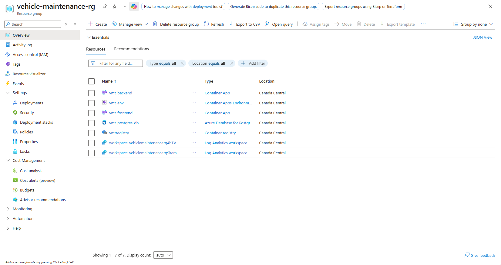
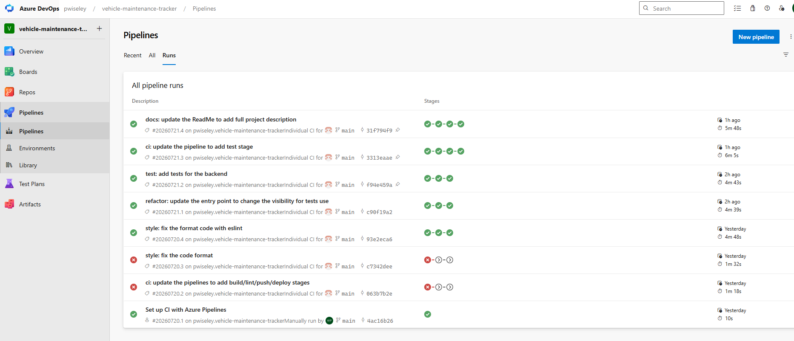
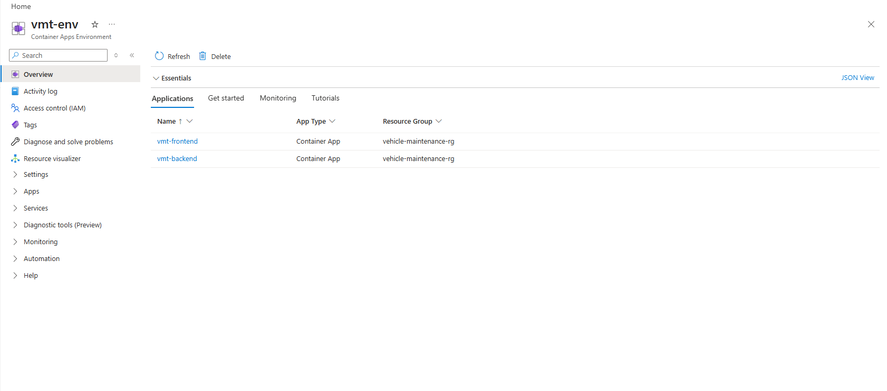

# Vehicle Maintenance Tracker

Fleet maintenance tracking API: logs service history per vehicle, tracks maintenance status, and surfaces fleet-wide metrics through a dashboard endpoint.

> [Live Demo](https://vmt.petiton.dev)

## Overview

Fleet operators can register vehicles, log maintenance interventions against them, and follow each intervention through a status workflow (scheduled → in progress → completed). A dashboard endpoint aggregates fleet-wide metrics: total maintenance cost, upcoming interventions, and status distribution.

The backend is a containerized ASP.NET Core API with a React frontend, deployed on Azure Container Apps behind an nginx reverse proxy. An Azure DevOps pipeline builds, lints, tests, and deploys on every push to `main`.

## Tech Stack

| Layer | Technology |
|---|---|
| Backend | C#, ASP.NET Core 10, Entity Framework Core |
| Frontend | React, TypeScript, Vite |
| Database | PostgreSQL 16 |
| Testing | xUnit, Testcontainers, Respawn, FluentAssertions |
| CI/CD | Azure DevOps Pipelines |
| Hosting | Azure Container Apps, Azure Container Registry, nginx |
| Architecture | Controller / Service / DbContext |

## Features

- Vehicle registry with type classification (car, truck, snow plow, service vehicle)
- Maintenance history per vehicle with cost and mileage tracking
- Status workflow for each maintenance record
- Dashboard endpoint with LINQ-based aggregations
- REST API documented with Swagger / OpenAPI
- EF Core migrations for versioned schema changes
- Global exception handling with RFC 7807 ProblemDetails responses

## Testing

Integration tests run against a real PostgreSQL instance through Testcontainers. Migrations are applied to a disposable database, and Respawn resets state between tests. Assertions use FluentAssertions.

## API
> [API Docs (Swagger)](https://vmt.petiton.dev/swagger)

| Method | Route | Purpose |
|---|---|---|
| `POST` | `/api/vehicles` | Register a vehicle |
| `GET` | `/api/vehicles` | List all vehicles |
| `GET` | `/api/vehicles/{id}` | Get vehicle details |
| `POST` | `/api/vehicles/{id}/maintenance` | Log a maintenance record |
| `GET` | `/api/vehicles/{id}/maintenance` | List a vehicle's maintenance history |
| `PATCH` | `/api/maintenance/{id}/status` | Advance maintenance status |
| `GET` | `/api/dashboard` | Fleet-wide metrics |

Example: registering a vehicle with a plate number that already exists returns `409 Conflict` in ProblemDetails format.

```json
{
  "title": "Resource already exists",
  "status": 409,
  "detail": "A vehicle with plate number 'ABC123' already exists."
}
```

## Deployment

Images are built by the Azure DevOps pipeline, stored in Azure Container Registry, and deployed to Azure Container Apps.







## Related

- [insurance-quote](https://github.com/pwiseley/insurance-quote): Spring Boot + React, live at `primio.petiton.dev`
- [url-shortener](https://github.com/pwiseley/url-shortener): Spring Boot + Angular, live at `go.petiton.dev`
- [Floppa Marketplace](https://github.com/pwiseley/Floppa-app): Java REST API, three-layer architecture, CI/CD
- [Portfolio](https://petiton.dev)
